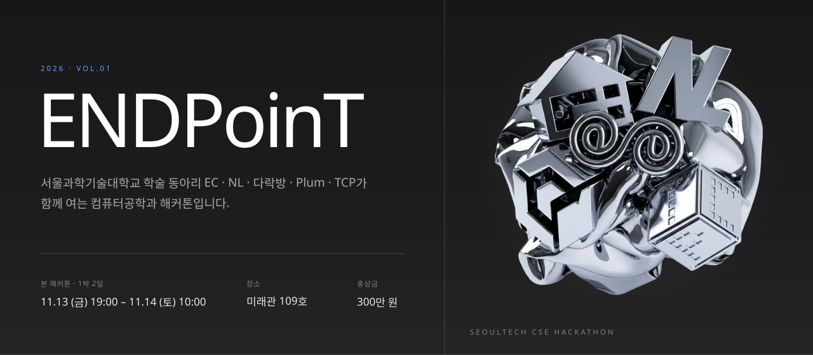
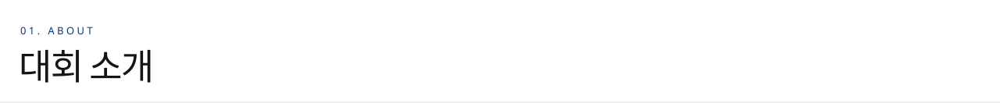
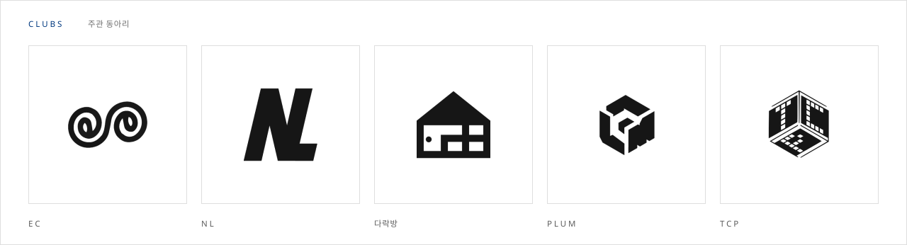
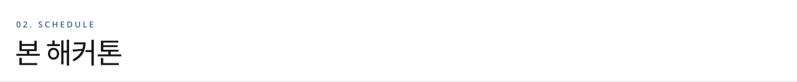
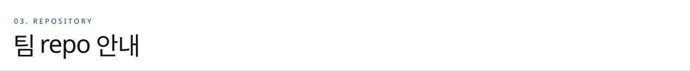
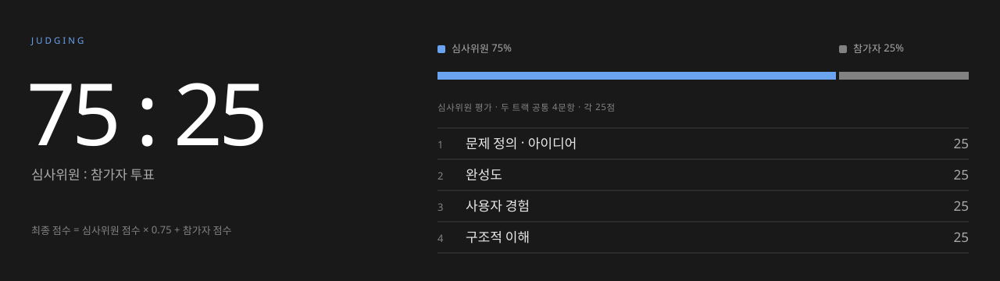
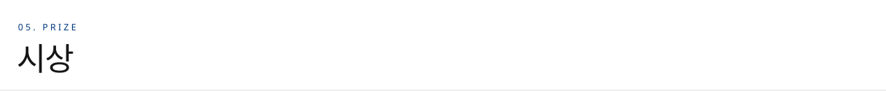

<a href="https://2026endpoint.github.io"></a>

<p>
<a href="https://2026endpoint.github.io"><b>대회 사이트</b></a> · 주관 컴퓨터공학과 · 주최 TCP · EC · NL · PLUM · 다락방
</p>



서로 다른 스택과 성격을 가진 다섯 학술 동아리가 처음으로 함께 여는 컴퓨터공학과 해커톤입니다.



**두 개의 트랙**

- **해커톤 트랙**: 주제를 받아 서비스를 새로 만듭니다.
- **구현과제 트랙**: 주어진 과제를 단계별로 구현합니다.



| | |
| --- | --- |
| 일시 | 11.13 (금) 19:00 – 11.14 (토), 1박 2일 |
| 장소 | 미래관 109호 |
| 개발 마감 | **11.14 (토) 10:00** · 이후 repo 수정 불가 |
| 발표 · 평가 | 11.14 (토) 10:00부터, 이후 시상과 경품 추첨 |



- 각 팀은 이 organization 안의 **자기 팀 repo**(`team01` ~ `team20`)에서 작업합니다. 다른 팀 repo는 볼 수 없습니다.
> 이때 팀의 레포를 public 으로 바꾸실 수 있습니다.
- 조장은 repo 관리 권한(maintain)을, 팀원은 쓰기 권한을 받습니다.
- **11.14 (토) 10:00에 모든 팀의 쓰기 권한이 읽기로 바뀌고**, 그 시점의 코드에 제출 태그가 붙습니다. 마감 뒤 push 기록은 GitHub 서버 시각으로 남습니다.
- 외부 서비스(Vercel, Render 등)를 연결할 때 GitHub 앱 설치 요청은, 운영진이 확인한 뒤 **자기 팀 repo에만** 허용합니다.




### 심사위원 평가

두 트랙 공통 4문항 · 각 25점, 100점

| # | 항목 | 배점 | 기준 |
| :-: | --- | :-: | --- |
| 1 | **문제 정의 · 아이디어** | 25 | 대상과 근거가 분명하고, 해결책이 문제와 맞물리며 참신한가<br> |
| 2 | **완성도** | 25 | 핵심 기능이 처음부터 끝까지 실제로 동작하는가<br><sub>라이브 데모로 확인 가능한 것들</sub> |
| 3 | **사용자 경험** | 25 | 처음 쓰는 사람도 헤매지 않고 주요 기능에 도달하는가 |
| 4 | **구조적 이해** | 25 | 결과물의 전체 구조와 설계 이유를 이해하고 설명하는가<br><sub>구성 요소가 어떻게 나뉘고 데이터가 어떻게 흐르는지, 왜 그렇게 설계했는지, 무엇을 바꾸면 어디가 영향을 받는지 등을 발표와 질의응답으로 확인. LLM으로 작성한 코드도 인정하며, 코드 한 줄 한 줄보다 전체 구조를 팀이 이해하고 있는지를 봅니다</sub> |
| | **합계** | **100** | |

배점은 기본안이며 발표 전 심사위원 합의로 조정할 수 있습니다.

### 참가자 평가 (인기투표 · 15점)

| | |
| --- | --- |
| 방식 | 1인 3표, 좋았던 팀 3곳에 1표씩<br><sub>한 팀에 중복 투표 불가 · 자기 팀 투표 불가</sub> |
| 투표 시점 | 트랙별 발표가 모두 끝난 직후 1회씩<br><sub>참가자 전원이 두 트랙 모두 투표</sub> |
| 점수 | 아래 식으로 **트랙별로 따로** 계산합니다 |

```math
P_i = 15 \times \sqrt{\min\left(1,\ \frac{v_i}{2\bar{v}}\right)}, \qquad \bar{v} = \frac{V}{N}
```

- $v_i$: $i$팀의 득표수, $V$: 그 트랙에서 나온 전체 표 수, $N$: 그 트랙의 팀 수, $\bar{v}$: 팀당 평균 득표
- **평균의 2배 이상**을 받으면 만점(15점)입니다. 표가 한 팀에 몰려도 그 팀은 15점에서 멈추고, 1위 팀이 몇 표를 받았는지는 다른 팀 점수에 영향을 주지 않습니다.
- 제곱근을 쓰기 때문에 적게 받은 팀일수록 한 표의 가치가 커서, 표 쏠림으로 생기는 점수 차가 줄어듭니다.

<details>
<summary>예시: 10팀 트랙, 60명 투표 (전체 180표, 평균 18표, 만점 기준 36표)</summary>

| 득표 | 새 방식 (15점) | 이전 방식 (1위 80표일 때, 25점) |
| :-: | :-: | :-: |
| 80 | 15.00 | 25.00 |
| 36 | 15.00 | 11.25 |
| 27 | 12.99 | 8.44 |
| 18 | 10.61 | 5.63 |
| 9 | 7.50 | 2.81 |
| 3 | 4.33 | 0.94 |
| 0 | 0.00 | 0.00 |

</details>

### 점수 합산

```math
S_i = 0.85 \times J_i + P_i \qquad (100 = 85 + 15)
```

| | |
| --- | --- |
| 최종 점수 $S_i$ | 심사위원 점수 × 0.85 + 참가자 점수 |
| 심사위원 점수 $J_i$ | 심사위원 원점수(100점 만점)의 평균 |
| 참가자 점수 $P_i$ | 위 식, 15점 만점 |
| 동점 처리 | 심사위원 점수 → 구조적 이해 점수 순 |

### 발표 및 운영

| | |
| --- | --- |
| 발표 시간 | 팀당 5~10분 |
| 질의응답 | 심사위원 재량으로 자유롭게 질문 |
| 발표 형식 | 자유 (슬라이드, 시연, 영상 등) |
| 제출 마감 | 11.14 (토) 10:00 이후 수정 불가 |
> 캡스톤디자인 작품과 중복될시, 실격될 수 있습니다.



총상금 **300만 원**

| 해커톤 트랙 | 상금 | | 구현과제 트랙 | 상금 |
| --- | --- | --- | --- | --- |
| 1등 (1팀) | 70만 원 | | 1등 (1팀) | 35만 원 |
| 2등 (2팀) | 40만 원 | | 2등 (1팀) | 25만 원 |
| 3등 (3팀) | 20만 원 | | 3등 (1팀) | 20만 원 |
| | | | 4등 (1팀) | 10만 원 |

경품 추첨은 둘째 날 새벽에 진행됩니다.

<br>

<sub>ENDPoinT · SeoulTech CSE Hackathon · 문의는 소속 동아리 운영진이나 [대회 사이트](https://2026endpoint.github.io)의 문의 메일로 보내 주세요.</sub>
