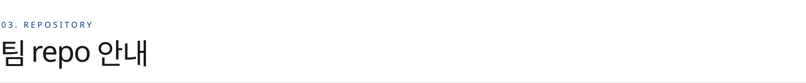
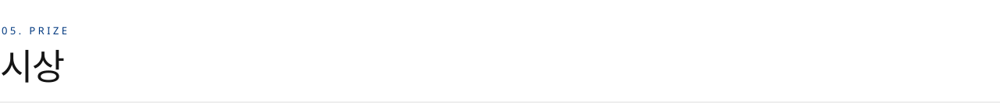

<a href="https://2026endpoint.github.io"><b>대회 사이트</b></a> · 주관 컴퓨터공학과 · 주최 TCP · EC · NL · PLUM · 다락방

<picture>
  <source media="(prefers-color-scheme: dark)" srcset="https://raw.githubusercontent.com/2026ENDPoinT/.github/main/profile/assets/h01-dark.svg">
  
</picture>

서로 다른 스택과 성격을 가진 다섯 학술 동아리가 처음으로 함께 여는 컴퓨터공학과 해커톤입니다.

**두 개의 트랙**

- **해커톤 트랙**: 주제를 받아 서비스를 새로 만듭니다.
- **구현과제 트랙**: 주어진 과제를 단계별로 구현합니다.

<picture>
  <source media="(prefers-color-scheme: dark)" srcset="https://raw.githubusercontent.com/2026ENDPoinT/.github/main/profile/assets/h02-dark.svg">
  
</picture>

| | |
| --- | --- |
| 일시 | 11.13 (금) 19:00 – 11.14 (토), 1박 2일 |
| 장소 | 미래관 109호 |
| 개발 마감 | **11.14 (토) 10:00** · 이후 repo 수정 불가 |
| 발표 · 평가 | 11.14 (토) 10:00부터, 이후 시상과 경품 추첨 |

<picture>
  <source media="(prefers-color-scheme: dark)" srcset="https://raw.githubusercontent.com/2026ENDPoinT/.github/main/profile/assets/h03-dark.svg">
  
</picture>

- 각 팀은 이 organization 안의 **자기 팀 repo**(`team01` ~ `team20`)에서 작업합니다. 다른 팀 repo는 볼 수 없습니다.
- 조장은 repo 관리 권한(maintain)을, 팀원은 쓰기 권한을 받습니다.
- **11.14 (토) 10:00에 모든 팀의 쓰기 권한이 읽기로 바뀌고**, 그 시점의 코드에 제출 태그가 붙습니다. 마감 뒤 push 기록은 GitHub 서버 시각으로 남습니다.
- README에 아래 네 섹션을 채워 주세요. 심사 때 확인합니다.
  - `서비스 링크`: 배포 주소, 데모 영상, 발표 자료
  - `기술 스택`
  - `구현한 기능`: 실제로 동작하는 기능만
  - `못 한 것`: 계획했지만 못 한 것, 알려진 버그
- API 키, `.env`, 비밀번호 같은 비밀 값은 커밋하지 마세요. 한 번 커밋하면 지워도 기록에 남습니다.
- 외부 서비스(Vercel, Render 등)를 연결할 때 GitHub 앱 설치 요청이 운영진에게 갑니다. 운영진이 확인한 뒤 **자기 팀 repo에만** 허용합니다.

<picture>
  <source media="(prefers-color-scheme: dark)" srcset="https://raw.githubusercontent.com/2026ENDPoinT/.github/main/profile/assets/h04-dark.svg">
  
</picture>

### 심사위원 평가

두 트랙 공통 4문항 · 각 25점, 100점

| # | 항목 | 배점 | 기준 |
| :-: | --- | :-: | --- |
| 1 | **문제 정의 · 아이디어** | 25 | 대상과 근거가 분명하고, 해결책이 문제와 맞물리며 참신한가 좁고 깊은 문제, 넓고 공감되는 문제 모두 인정 |
| 2 | **완성도** | 25 | 핵심 기능이 처음부터 끝까지 실제로 동작하는가 라이브 데모 또는 녹화 영상으로 확인된 기능만 인정 |
| 3 | **사용자 경험** | 25 | 처음 쓰는 사람도 헤매지 않고 주요 기능에 도달하는가 |
| 4 | **구조적 이해** | 25 | 결과물의 전체 구조와 설계 이유를 이해하고 설명하는가 구성 요소가 어떻게 나뉘고 데이터가 어떻게 흐르는지, 왜 그렇게 설계했는지, 무엇을 바꾸면 어디가 영향을 받는지를 발표와 질의응답으로 확인. AI가 작성한 코드도 인정하며, 코드 한 줄 한 줄보다 전체 구조를 팀이 이해하고 있는지를 봅니다 |
| | **합계** | **100** | |

배점은 기본안이며 발표 전 심사위원 합의로 조정할 수 있습니다. 심사위원은 팀별 한 줄 코멘트를 함께 남깁니다.

### 참가자 평가 (인기투표 · 25점)

| | |
| --- | --- |
| 방식 | 1인 3표, 좋았던 팀 3곳에 1표씩 한 팀에 중복 투표 불가 · 자기 팀 투표 불가 |
| 투표 시점 | 트랙별 발표가 모두 끝난 직후 1회씩 참가자 전원이 두 트랙 모두 투표 |
| 점수 | 팀 득표수 ÷ 1위 팀 득표수 × 25 예) 1위 30표 → 25점, 15표 → 12.5점 |

### 점수 합산

| | |
| --- | --- |
| 최종 점수 | 심사위원 점수 × 0.75 + 참가자 점수 100점 만점 = 75점 + 25점 |
| 심사위원 점수 | 심사위원 원점수(100점 만점)의 평균 |
| 동점 처리 | 심사위원 점수 → 구조적 이해 점수 순 |

### 발표 및 운영

| | |
| --- | --- |
| 발표 시간 | 팀당 5~10분 |
| 질의응답 | 심사위원 재량으로 자유롭게 질문 |
| 발표 형식 | 자유 (슬라이드, 시연, 영상 등) |
| 제출 마감 | 11.14 (토) 10:00 이후 수정 불가 |
| 중복 작품 | 캡스톤디자인 작품과 중복 시 실격 가능 |

<picture>
  <source media="(prefers-color-scheme: dark)" srcset="https://raw.githubusercontent.com/2026ENDPoinT/.github/main/profile/assets/h05-dark.svg">
  
</picture>

총상금 **300만 원**

| 해커톤 트랙 | 상금 | | 구현과제 트랙 | 상금 |
| --- | --- | --- | --- | --- |
| 1등 (1팀) | 70만 원 | | 1등 (1팀) | 35만 원 |
| 2등 (2팀) | 40만 원 | | 2등 (1팀) | 25만 원 |
| 3등 (3팀) | 20만 원 | | 3등 (1팀) | 20만 원 |
| | | | 4등 (1팀) | 10만 원 |

경품 추첨은 둘째 날 새벽에 진행됩니다.

 

ENDPoinT · SeoulTech CSE Hackathon · 문의는 소속 동아리 운영진이나 [대회 사이트](https://2026endpoint.github.io)의 문의 메일로 보내 주세요.
